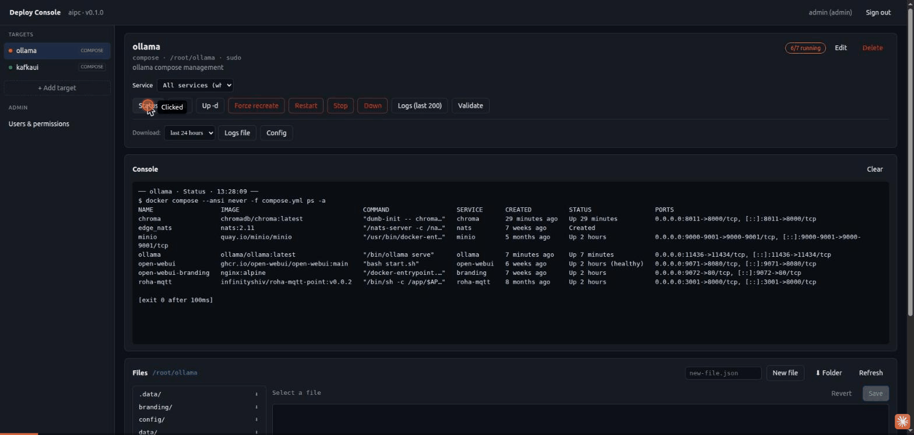

<div align="center">

# 🚀 generic-deployer

**A small, self-hosted web console for deploying and operating Docker Compose stacks and systemd services, with per-user, per-service permissions.**

One static binary · No database · No agents · Works on any Linux server (and macOS for Compose)

</div>

---



<sub>*The admin opens a stack, checks its status, and creates a user who may only pull, update, restart and read logs for the `chroma` service, with read-write access to that service's volume folder.*</sub>

---

## Table of contents

- [Why](#-why)
- [Features](#-features)
- [How it works](#-how-it-works)
- [Requirements](#-requirements)
- [Install](#-install)
  - [Ubuntu / Debian](#ubuntu--debian)
  - [RHEL / Rocky / Alma / Fedora](#rhel--rocky--alma--fedora)
  - [Arch / other systemd Linux](#arch--other-systemd-linux)
  - [macOS](#macos)
  - [Build from source](#build-from-source)
- [Configuration](#-configuration)
- [Using the console](#-using-the-console)
- [Users & permissions](#-users--permissions)
- [Running as root vs. sudo mode](#-running-as-root-vs-sudo-mode)
- [Security model](#-security-model)
- [HTTP API](#-http-api)
- [Troubleshooting](#-troubleshooting)
- [Development](#-development)

---

## 💡 Why

On a typical server you have a few `docker compose` stacks (`/root/ollama`, `/root/n8n`, …) and some systemd
services. Today, everyone who has to *pull a new image*, *restart one container*, *tweak a `.env`* or *read logs*
needs an SSH login, and usually root.

**generic-deployer** puts those operations behind a browser UI:

- **Operators get exactly what they need.** "Restart and pull the `chroma` service, edit files in its volume
  folder, read its logs" — and nothing else. No SSH, no root.
- **Admins keep full control.** Add stacks and services, decide per user which actions, which compose services and
  which folders (read-only or read-write) they get.
- **Every action is audited** to the journal: who did what, when, with which exit code.
- **It's generic.** It doesn't know or care what your services are. Point it at a compose directory or a unit name.

## ✨ Features

| | Docker Compose target | systemd target |
|---|---|---|
| **Actions** | Status · Stats · Start · Pull · Up -d · Force recreate · Restart · Stop · Down · Logs · Validate | Stats · Status · Start · Restart · Stop · Enable · Disable · Logs · Daemon reload |
| **Stats** | `docker compose stats --no-stream`: CPU, memory, network, disk I/O, PIDs per container | State, uptime, CPU now and total, memory (and peak), tasks, restarts, process list |
| **Deploy without a registry** | ⇪ Load image: upload a `docker save` archive → `docker load` → `up -d` | ⇪ Update binary: upload a build that replaces the service's binary → restart |
| **Per service** | Pick one service in the stack (services behind `profiles:` included); actions run only on it (`up -d --no-deps <svc>`) | — |
| **Live output** | Command output streams into the browser console | same |
| **Downloads** | Full logs file (1h / 6h / 24h / 7d / all), resolved `docker compose config` | Full journal, `systemctl cat` unit |
| **Files** | Browse, edit, create, download the project dir, extra dirs, service volume folders | Browse/edit/download its config & data dirs |
| **Custom buttons** | e.g. `migrate = ./scripts/migrate.sh --up` | same |

**Plus:**

- 🧩 **Multiple stacks per server.** Each compose directory or unit is a *target*. Add as many as you like from the UI.
- 👥 **Users with grants:** actions × compose services × folders (ro / rw) per target. Admin users have full control.
- 📝 **Safe editing:** `.json`, `.yaml/.yml`, `.csv/.tsv` are validated before saving (with line numbers). Every save
  keeps a timestamped backup and rewrites the file in place, so owner, mode and Docker bind-mounts are preserved.
- 📦 **Downloads:** any file (binary or large too) or a whole folder as `.tar.gz`.
- 🪶 **Light:** the UI shows the last 200 log lines; full logs go to a download. A few MB of RAM when idle.
- 🔐 **sudo mode:** run the console as a normal user and let the admin flip "Use sudo" per target.
- ♻️ **Self-aware:** restarting the console's own unit from the UI works (it answers first, then restarts, and
  the page reconnects; you stay signed in).

## 🧠 How it works

```
 Browser ──HTTPS/HTTP──►  generic-deploy (one Go binary, embedded UI)
                              │
                              ├─ deploy.yaml   main config: listen, built-in admin, sudo, backups
                              ├─ targets.yaml  targets the admin added in the UI
                              ├─ users.yaml    users + grants (bcrypt password hashes)
                              │
                              ├─► docker compose …   (in each target's directory)
                              ├─► systemctl / journalctl …
                              └─► files under the granted folders only
```

- The browser **never sends a command line**: only *target + action name* (and optionally a compose service).
  The actual command is fixed in code or written by an admin.
- Every request is checked against the caller's grants on the server; the UI only hides what you can't use.

## 📋 Requirements

| | Needed for |
|---|---|
| **Linux** (any distro) or **macOS** | Running the console |
| **Docker Engine + Compose v2** (`docker compose`) | Compose targets |
| **systemd** | systemd targets and running the console as a service (Linux only) |
| **GNU coreutils / findutils** | sudo mode only (`env -C`, `realpath -m`, `find -printf`), standard on Linux |
| Go **1.23+** | Only to build from source |

Resources: ~5–30 MB RAM, negligible CPU (short spikes while `docker compose` runs). Default port **8090**.

## 📥 Install

The console is a single static binary. Grab it from `make build-all` (see [Build from source](#build-from-source))
or a release, then follow the steps for your OS.

### Ubuntu / Debian

```bash
# 1. Docker + compose plugin (skip if installed)
sudo apt-get update && sudo apt-get install -y docker.io docker-compose-v2   # or Docker's official repo

# 2. Install the console
sudo mkdir -p /opt/generic-deploy && cd /opt/generic-deploy
sudo cp /path/to/generic-deploy-linux-amd64 ./generic-deploy      # use -linux-arm64 on ARM servers
sudo chmod 755 generic-deploy
sudo cp /path/to/deploy.example.yaml ./deploy.yaml
sudo chmod 600 deploy.yaml
sudo nano deploy.yaml            # set auth.password (it refuses to start while it is CHANGE-ME)

# 3. Run it as a systemd service
sudo cp /path/to/generic-deploy.service /etc/systemd/system/
sudo systemctl daemon-reload
sudo systemctl enable --now generic-deploy
sudo systemctl status generic-deploy --no-pager

# 4. Open the port if a firewall is on
sudo ufw allow 8090/tcp
```

Open `http://<server>:8090` and sign in with the `auth` user from `deploy.yaml`.

> ⚠️ **chmod gotcha:** the **binary** needs `755`, the **config** needs `600`. If `systemctl status` shows
> `status=203/EXEC`, the binary lost its execute bit (`chmod 755 /opt/generic-deploy/generic-deploy`).

### RHEL / Rocky / Alma / Fedora

```bash
sudo dnf install -y dnf-plugins-core
sudo dnf config-manager --add-repo https://download.docker.com/linux/centos/docker-ce.repo   # Fedora: …/linux/fedora/docker-ce.repo
sudo dnf install -y docker-ce docker-ce-cli containerd.io docker-compose-plugin
sudo systemctl enable --now docker

# then steps 2–3 from Ubuntu, and open the port:
sudo firewall-cmd --permanent --add-port=8090/tcp && sudo firewall-cmd --reload
```

On SELinux-enforcing hosts keep the binary under `/opt` or `/usr/local/bin` (default contexts work).

### Arch / other systemd Linux

```bash
sudo pacman -S docker docker-compose && sudo systemctl enable --now docker   # Arch
# any other distro: install Docker Engine + the compose v2 plugin from your package manager or docs.docker.com
```

Then steps 2–3 from Ubuntu. Anything with systemd works the same way.

**Linux without systemd** (Alpine/OpenRC, containers…): Compose targets work; skip systemd targets and run the
console with your init system or in `tmux`/`screen`:
`/opt/generic-deploy/generic-deploy -config /opt/generic-deploy/deploy.yaml`.

### macOS

macOS has no systemd, so **only Compose targets** are available. Docker Desktop (or OrbStack/Colima) provides
`docker compose`.

```bash
mkdir -p ~/generic-deploy && cd ~/generic-deploy
cp /path/to/generic-deploy-darwin-arm64 ./generic-deploy     # Intel Macs: -darwin-amd64
chmod 755 generic-deploy
xattr -d com.apple.quarantine generic-deploy 2>/dev/null       # allow an unsigned binary
cp /path/to/deploy.example.yaml deploy.yaml && chmod 600 deploy.yaml
# edit deploy.yaml: set auth.password, listen: "127.0.0.1:8090", and
#   backupDir: /Users/<you>/generic-deploy/backups   (the default under /var/lib isn't writable)
./generic-deploy -config deploy.yaml
```

To start it at login, create `~/Library/LaunchAgents/com.generic-deploy.plist`:

```xml
<?xml version="1.0" encoding="UTF-8"?>
<!DOCTYPE plist PUBLIC "-//Apple//DTD PLIST 1.0//EN" "http://www.apple.com/DTDs/PropertyList-1.0.dtd">
<plist version="1.0"><dict>
  <key>Label</key><string>com.generic-deploy</string>
  <key>ProgramArguments</key><array>
    <string>/Users/YOU/generic-deploy/generic-deploy</string>
    <string>-config</string><string>/Users/YOU/generic-deploy/deploy.yaml</string>
  </array>
  <key>WorkingDirectory</key><string>/Users/YOU/generic-deploy</string>
  <key>RunAtLoad</key><true/>
  <key>KeepAlive</key><true/>
  <key>StandardOutPath</key><string>/Users/YOU/generic-deploy/console.log</string>
  <key>StandardErrorPath</key><string>/Users/YOU/generic-deploy/console.log</string>
</dict></plist>
```

```bash
launchctl load ~/Library/LaunchAgents/com.generic-deploy.plist
```

(sudo mode relies on GNU tools and is Linux-only; on macOS run the console as the user that owns Docker.)

### Build from source

```bash
git clone https://github.com/shivamkkas/generic-deployer.git
cd generic-deployer
make test          # unit + HTTP tests
make build         # bin/generic-deploy            (linux/amd64)
make build-all     # dist/  linux amd64+arm64, darwin amd64+arm64
```

Copy the binary to the server, e.g. `scp dist/generic-deploy-linux-amd64 root@server:/opt/generic-deploy/generic-deploy`.

**Upgrading** a running install safely:

```bash
scp bin/generic-deploy root@server:/opt/generic-deploy/generic-deploy.new
ssh root@server 'cd /opt/generic-deploy && chmod 755 generic-deploy.new && mv generic-deploy.new generic-deploy && systemctl restart generic-deploy'
```

## ⚙️ Configuration

`deploy.yaml` (keep it `chmod 600`):

```yaml
listen: "0.0.0.0:8090"
# tlsCert: /etc/generic-deploy/cert.pem     # recommended outside a trusted network
# tlsKey:  /etc/generic-deploy/key.pem

auth:                       # built-in super admin: always full control
  user: admin
  password: "CHANGE-ME"     # refuses to start until you change it

sudo:
  password: ""              # only when running as a normal user (see sudo mode); or env GENERIC_DEPLOY_SUDO_PASSWORD

backupDir: /var/lib/generic-deploy/backups
maxFileBytes: 1048576       # largest file the editor opens (downloads are unlimited)
maxUploadBytes: 1073741824  # largest upload (default 1 GiB)
# targetsFile: targets.yaml # default: next to deploy.yaml
# usersFile:   users.yaml   # default: next to deploy.yaml
```

Targets and users are created **in the UI** and stored in `targets.yaml` / `users.yaml` (0600). You can seed
targets once with a `targets:` list in `deploy.yaml`; after the first start the UI is the source of truth.

## 🖥️ Using the console

1. **Add a target** (admin): sidebar → **+ Add target**.
   - *Compose:* name, the project directory (e.g. `/root/n8n`), optional compose files (`compose.yml`,
     `docker-compose.prod.yml`) and extra folders. After saving, **Edit → "Add the services' volume folders"** reads
     the compose file and adds every bind-mount folder.
   - *systemd:* name, unit (`nginx.service`), optional working/data directory and extra folders.
2. **Operate:** pick a target, optionally a **Service**, then click an action. Red buttons ask for a second click.
   Output streams into the console; long output is trimmed on screen, so use **Download → Logs file** for everything.
3. **Edit files:** choose a folder, open a file, edit, **Save** (Ctrl+S). Invalid JSON/YAML/CSV is refused with the
   line number unless you click **Save anyway**. The previous version is kept in `backupDir`.
4. **Download:** ⬇ next to any file or folder, **Logs file**, or **Config**.
5. **Upload / update a binary:** in a folder you have read-write, **⇪ Upload** puts a file there (any size, binary
   too). To replace an existing file with a differently named local file (e.g. `myapp-linux-amd64` → `myapp`),
   click ⇪ on that file's row. The upload is written to a temp file next to it and renamed over the old one, so it
   works while the service is running (no "text file busy"); the old file's mode and owner are kept and the
   previous version goes to `backupDir`. Afterwards the console offers to **Restart** the target so the new
   version runs. New files without an extension are made executable (0755).

   For a systemd service, add the folder holding its binary (e.g. `/opt/myapp`) to the target's folders and give
   operators `rw` on it plus the `restart` action.
6. **Deploy a build without a registry:** for builds that can't be pulled.
   - **systemd:** set **Service binary** in the target (or click **Detect from unit** to read it from `ExecStart`).
     The target gets an **⇪ Update binary** button: pick the new build (any file name), it replaces the binary at
     that path (atomically, mode/owner kept, old version backed up, symlinks followed), then optionally restarts.
   - **compose:** **⇪ Load image** takes an archive from `docker save` (plain or `.gz`), runs `docker load`, then
     optionally `up -d` (for the chosen service or the whole project) so containers use the new image. Set
     **Image upload folder** to keep the archives there; otherwise they are deleted after loading.
   - **compose, no network / firewalled server:** with an **Image upload folder** set, **⇪ Load image** opens a
     list of the archives in that folder. Copy them there any way you like (`scp`, USB, a file share), click
     **Load**, and the console runs `docker load -i <file>` (then optionally `up -d`). Old archives stay, so
     loading an earlier one is a rollback. Only plain files directly in the folder are offered (symlinks that
     lead elsewhere are refused).

   Grant users the `deploy` action to allow it; restarting afterwards also needs `restart` (systemd) / `up` (compose).

## 👥 Users & permissions

Sidebar → **Users & permissions** → **+ New user**. For each target, tick:

| Grant | Effect |
|---|---|
| **Actions** | Which buttons the user gets (or *All actions*). Includes **Stats** and **deploy** (⇪ Update binary / ⇪ Load image); restarting after a deploy also needs **restart** (systemd) or **up** (compose). |
| **Services** *(compose)* | Limit the user to these services. Every action then targets only those services, and whole-project actions (Down, Validate, custom scripts) are hidden. Leave empty for the whole stack. |
| **Folders** | Directories the user can open, each **read-only** or **read-write**. Must be inside the target's folders. One-click suggestions include each service's volume folder. |

- **Admin** users get everything, including managing targets and users.
- **Disabled** users can't sign in. Changing a password, disabling or deleting a user signs them out everywhere.
- Users never see targets they have no grant for.

**Example:** a data-science operator may *Status, Pull, Up, Restart, Logs* only the `chroma` service of the `ollama`
stack, and edit only `/root/ollama/data/chroma-data`. That's what the demo above shows.

## 🔑 Running as root vs. sudo mode

| | **Run as root** (default unit file) | **Run as a normal user + sudo** |
|---|---|---|
| Setup | nothing extra | set `sudo.password` in `deploy.yaml`, add `User=` to the unit |
| Who needs root access | every target works | admin ticks **Use sudo** per target |
| Commands | run directly | `sudo -S` with the password on stdin (never in `ps`) |
| Files | direct | list/read/save/download via sudo; saves keep owner & mode |

When the console runs as root, "Use sudo" is ignored (not needed), so the auth log stays quiet. The sudo password is
checked at startup; if it's wrong you'll see a warning in the journal and the UI marks sudo as unavailable.

## 🛡️ Security model

- **No free-form shell.** Only fixed actions or admin-defined command buttons.
- **Server-side authorization** of every request against the caller's grants.
- **Path confinement:** `..` and symlinks pointing outside a granted folder are refused (also under sudo).
- **Sessions:** HttpOnly + SameSite=Strict cookies, 12 h sliding expiry, persisted as SHA-256 hashes only, so a
  restart doesn't sign people out. State-changing requests also require an `X-Console` header (CSRF).
- **Passwords:** bcrypt; failed logins are delayed and logged.
- **Audit log:** logins, actions (with exit code), saves, downloads, and target/user changes →
  `journalctl -u generic-deploy`.
- **One action at a time per target**; commands keep running if the browser tab closes.
- **Uploads/deploys** are size-limited (`maxUploadBytes`), audited with their SHA-256, and back up what they replace.
  Saved images can only be loaded from plain files directly inside the target's image folder.

> 🔒 **Recommendations:** keep `deploy.yaml` at `chmod 600`; enable `tlsCert`/`tlsKey` or put the console behind
> a TLS reverse proxy if it's reachable beyond a trusted network. Anyone with an **admin** login effectively controls
> the host: treat it like root SSH.

## 🔌 HTTP API

Used by the UI; also works with `curl -u user:pass` (basic auth). Mutating requests need `-H 'X-Console: 1'`.

```
POST /api/login                     {"user","password"} → session cookie
GET  /api/me
GET  /api/targets                   targets you can see, with your actions/services/folders
GET  /api/targets/{t}/state         {"state":"3/3 running" | "active" …, "busy":bool}
GET  /api/targets/{t}/services      compose services (+ volume folders for admins)
POST /api/targets/{t}/run/{action}[?service=svc]      streams output
GET  /api/targets/{t}/logs?since=1h|6h|24h|7d|all[&service=svc]   download
GET  /api/targets/{t}/config                          download
GET  /api/targets/{t}/files?root=N&path=
GET  /api/targets/{t}/file?root=N&path=
PUT  /api/targets/{t}/file?root=N&path=[&create=1][&force=1]
GET  /api/targets/{t}/download?root=N&path=           file or folder (.tar.gz)
POST /api/targets/{t}/upload?root=N&path=[&overwrite=1][&exec=1]   raw body; atomic replace
POST /api/targets/{t}/deploy?[service=][&name=x.tar][&restart=1]   raw body; new binary / docker image
POST /api/targets/{t}/deploy?file=x.tar[&service=][&restart=1]      compose: docker load a file already in imageDir
GET  /api/targets/{t}/images                                        compose: archives in imageDir
POST|PUT|DELETE /api/admin/targets[/{t}]              admin
GET|POST|PUT|DELETE /api/admin/users[/{u}]            admin
```

Example:

```bash
curl -u ops:secret -H 'X-Console: 1' -X POST "http://server:8090/api/targets/ollama/run/restart?service=chroma"

# ship a new binary to a systemd service and restart it (e.g. from CI)
curl -fu ops:secret -H 'X-Console: 1' --data-binary @dist/myapp-linux-amd64 \
  "http://server:8090/api/targets/myapp/upload?root=0&path=myapp&overwrite=1"
curl -fu ops:secret -H 'X-Console: 1' -X POST "http://server:8090/api/targets/myapp/run/restart"

# or in one call: replace the target's configured binary and restart
curl -fu ops:secret -H 'X-Console: 1' --data-binary @dist/myapp-linux-amd64 \
  "http://server:8090/api/targets/myapp/deploy?restart=1"

# compose: load an image built elsewhere (docker save myimg:tag | gzip > img.tar.gz) and recreate one service
curl -fu ops:secret -H 'X-Console: 1' --data-binary @img.tar.gz \
  "http://server:8090/api/targets/ollama/deploy?name=img.tar.gz&service=api&restart=1"

# firewalled server: copy the archive into the image folder yourself, then load it from there
scp img-1.3.tar.gz server:/opt/ollama/images/
curl -fu ops:secret -H 'X-Console: 1' -X POST \
  "http://server:8090/api/targets/ollama/deploy?file=img-1.3.tar.gz&service=api&restart=1"
```

## 🩺 Troubleshooting

| Symptom | Fix |
|---|---|
| `status=203/EXEC` | `chmod 755 /opt/generic-deploy/generic-deploy` (and check `uname -m` matches the binary) |
| Service exits immediately | `journalctl -u generic-deploy -n 30`: usually `auth.password` is still `CHANGE-ME` or YAML is invalid |
| "could not list services" | run `docker compose config --services` in the target dir; check the compose file name |
| "permission denied" on files / systemctl | run as root, or set `sudo.password` and tick **Use sudo** on that target |
| "Failed to fetch" / reconnecting banner | the console restarted; it reconnects automatically |
| Page unreachable from other machines | open the port (`ufw allow 8090/tcp` / `firewall-cmd`) and check `listen:` |

Resource usage: `systemctl show generic-deploy -p MemoryCurrent -p CPUUsageNSec -p TasksCurrent`.

## 🛠️ Development

```
cmd/generic-deploy/     main
internal/console/
  config.go             deploy.yaml + target validation
  store.go              targets.yaml (admin-managed targets)
  users.go              users.yaml, grants, sessions
  actions.go            fixed compose/systemd actions, service discovery (incl. profiles)
  stats.go              systemd resource stats
  upload.go             atomic file upload (replace running binaries)
  deploy.go             Update binary / Load image / load saved images, detect binary
  server.go             HTTP API, auth, permissions, action runner
  files.go              path confinement, editor I/O, content validation
  downloads.go          file/folder/logs/config downloads
  sudo.go               sudo-aware command + file layer
  self.go               restarting the console's own unit safely
  web/                  embedded UI (vanilla HTML/CSS/JS, no build step)
```

```bash
make test                      # all tests
GD_TEST_SUDO_PASSWORD=… go test -run TestSudoFS -v ./internal/console   # real sudo path
```
